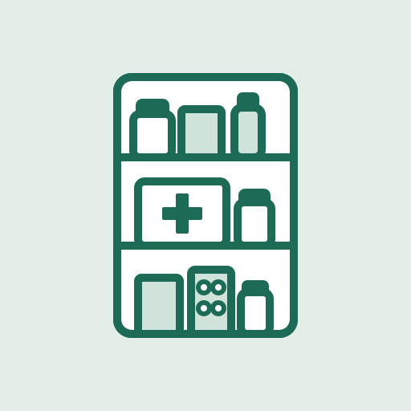
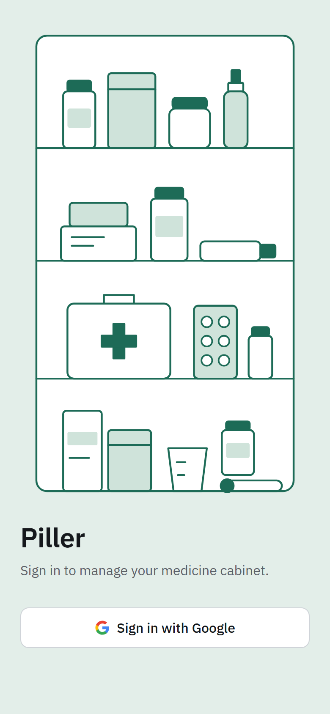
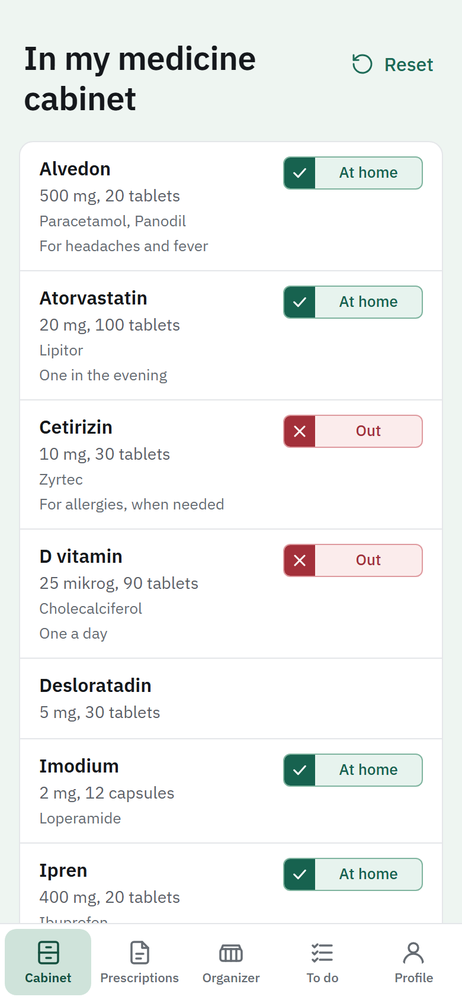
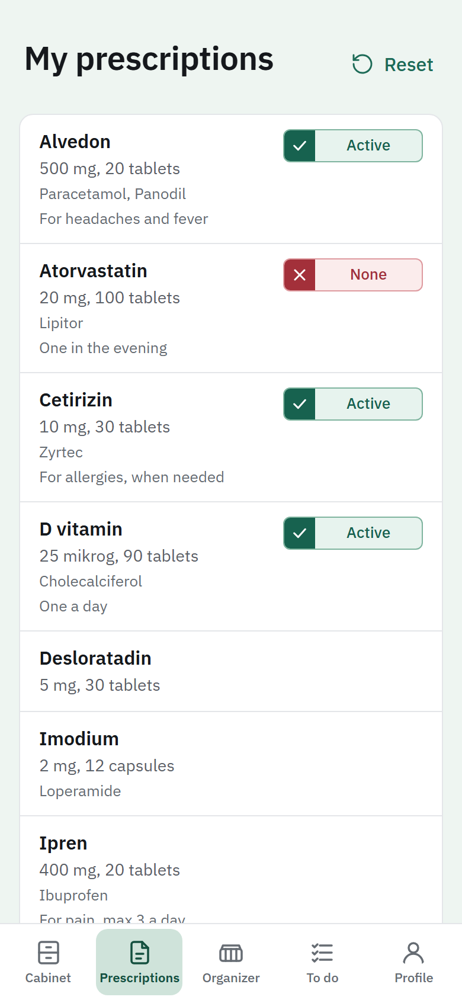
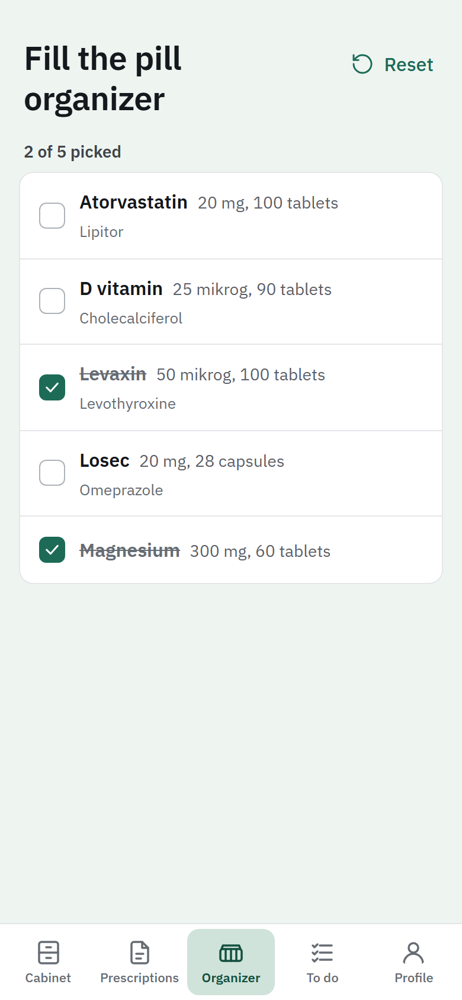
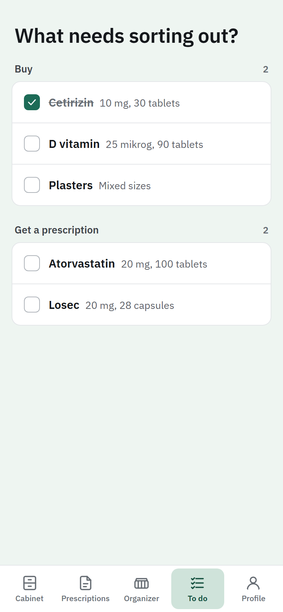
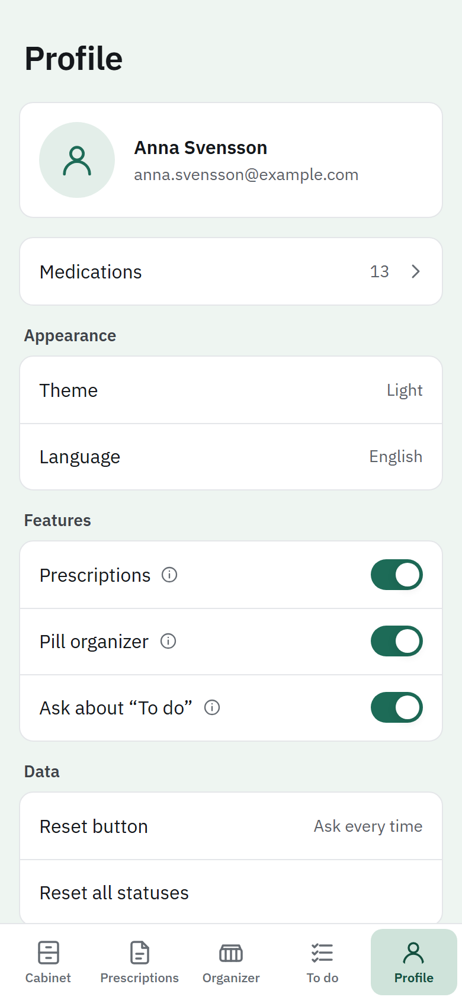
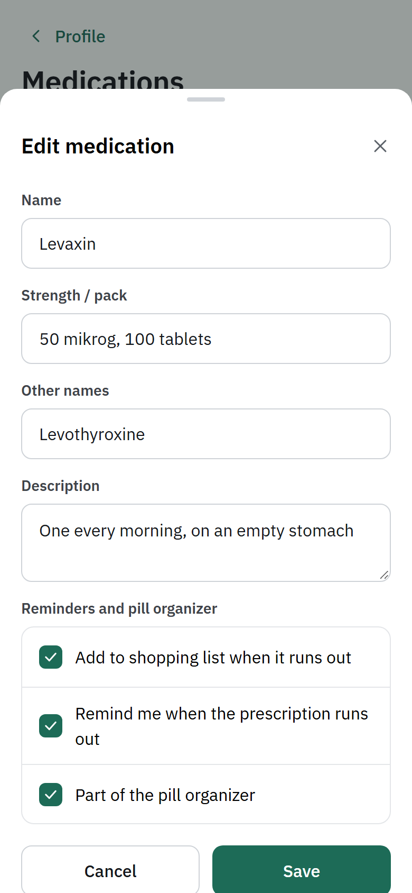
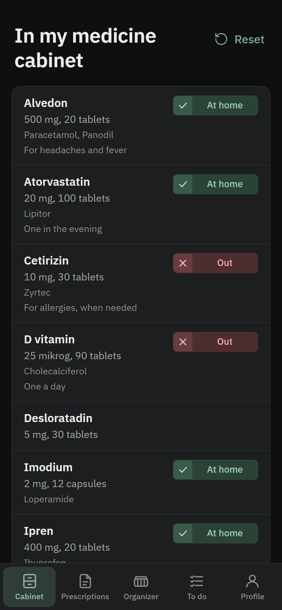

<p align="center">
  
</p>

<h1 align="center">Piller</h1>

<p align="center">
  <strong>A home medicine cabinet for your phone.</strong><br>
  See what's at home, what has run out, which prescriptions are active, and what to buy or renew next.
</p>

<p align="center">
  
  
  
  
</p>
<p align="center">
  
  
  
  
</p>

<p align="center"><sub>Screenshots show the English interface with made-up sample data. The app is also available in Swedish.</sub></p>

## The idea

Most homes have a cabinet full of medicines and no idea what is in it until someone needs it. Is there any paracetamol left? Is the prescription still valid? Did anyone fill the pill organizer this week?

Piller answers those questions with one tap per medication. Each medicine has two statuses, one for the cabinet and one for its prescription. Everything you need to buy or renew then collects itself in one list.

## What you can do

**Keep track of the cabinet.** Tap a medication to cycle through unknown, at home and out. The list shows the name, strength, other names and a short note such as "one every morning, on an empty stomach". Medications are always sorted A to Z, with Swedish rules (å, ä and ö come after z).

**Keep track of prescriptions.** Prescriptions have their own status, separate from the cabinet: active, or none. A medication can be at home and still need a new prescription.

**A to-do list that builds itself.** Medications that have run out land under _Buy_, and those without a prescription under _Get a prescription_. Ticking an item resets its status, since a refill takes time to arrive. The item stays on the page, struck through, until you leave it, so a mis-tap is easy to see.

**Choose what reminds you.** For each medication you decide whether running out puts it on the list automatically. For those that don't, Piller asks when you mark one as out whether to add it by hand, and you can switch that question off.

**Fill the pill organizer.** The medications that go in it appear as a checklist with a count, such as "2 of 5 picked". One tap on Reset clears it for next week.

**Make it yours.**

- Light, dark or follow the phone. The dark theme has its own colours and isn't just the light one inverted.
- Swedish or English, or follow the phone.
- Switch off the parts you don't use: prescriptions, or the pill organizer.
- Decide what the Reset button does: ask every time, reset everything, or only what has run out.

**Works without a connection.** Piller installs on a phone's home screen like an app and opens offline with the last known lists. Changes made offline are sent when the connection comes back.

**Private by design.** You sign in with Google, and only people on an access list can use the app. Each person's medications and settings are stored separately, and the database's security rules enforce that.

## Design and quality

- **Not generic.** A calm mint palette, IBM Plex Sans, and thin dividers instead of heavy boxes. All colours, sizes and spacing come from a small set of design tokens, so light and dark mode share one structure.
- **Accessible.** Built for keyboard and screen readers: visible focus rings, labelled controls, a main landmark and a page title on every screen, drawers that keep focus inside while they are open, and text contrast checked against WCAG 2.2. Animations respect the "reduce motion" setting.
- **Careful engineering.** Strict TypeScript, unit tests for the rules that decide what goes on the to-do list, ESLint and Prettier on every commit, and a GitHub Actions pipeline that checks, builds and deploys every push to `main`.

## Built with

|                |                                                                                         |
| -------------- | --------------------------------------------------------------------------------------- |
| **App**        | [SvelteKit](https://svelte.dev/docs/kit) 3, Svelte 5 (runes), TypeScript                |
| **Backend**    | [Firebase](https://firebase.google.com): Google sign-in, Firestore, Hosting             |
| **Offline**    | A service worker made with `@vite-pwa/sveltekit` (Workbox), and Firestore's local cache |
| **Quality**    | Vitest, ESLint, Prettier, Husky and lint-staged                                         |
| **Deployment** | GitHub Actions, publishing to Firebase Hosting                                          |

There is no server of its own. The app talks to Firebase directly, and Firestore security rules decide who can read and write what.

## Run your own copy

You need a free Firebase project and a few minutes. [SETUP.md](SETUP.md) has everything, step by step: creating the project, signing in, running the app locally, deploying it, and how the code is organised.

```sh
npm install
cp .env.example .env   # then fill in your Firebase settings
npm run dev
```
